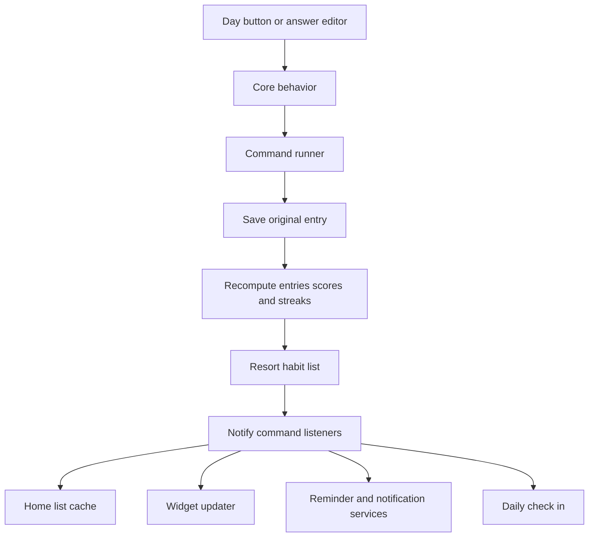

# Architecture and implementation notes

This guide describes the checked-in Flow application. See [the README](../README.md) for user-facing features and [AGENTS.md](../AGENTS.md) for commenting expectations.

## Modules and platform boundaries

The repository builds two modules:

| Module or source set | Responsibility |
| --- | --- |
| `uhabits-android` | Installable Android app, View-based screens, Android services, SQLite adapter, notifications, widgets, and integration receivers |
| `uhabits-core/commonMain` | Models, repositories, commands, tasks, preferences, platform abstractions, reusable presenters, and import and export |
| `uhabits-core/jvmMain` | JVM files, dates, graphics, database adapters, reminder scheduler, and day boundary timer |
| `uhabits-core/jsMain` | JavaScript implementations of platform abstractions used by the core browser target |

The actual source roots are `uhabits-core/src/<sourceSet>/`. Some JVM Kotlin files live beneath a directory named `java`; the directory name does not mean those files are Java sources.

The core's JavaScript target has browser tests. There is no separate web application module in the current settings. Dependencies are centralized in [the version catalog](../gradle/libs.versions.toml).

The release application ID is `dev.revilodev.flow`, and the debug variant installs separately as Flow Test with ID `dev.revilodev.flow.debug`. Both use the source namespace `org.isoron.uhabits`. Registered provider authorities and Android action names follow the variant application ID, while each package has independent app storage. Internal habit URIs also retain a legacy authority. Check the relevant intent factory, parser, receiver, and manifest together when working on integration identifiers.

## Application startup

[HabitsApplication](../uhabits-android/src/main/java/org/isoron/uhabits/HabitsApplication.kt) performs the following startup sequence:

1. Select the production database or the isolated test database.
2. Initialize the database opener and application dependency component.
3. Read preferences and set the current tracking date with the configured midnight delay.
4. Recompute derived data for all habits.
5. Start widget, reminder, notification tray, and daily check-in listeners.
6. Schedule reminders and refresh widgets through background tasks.

When an unsupported database version is raised during initialization, the application has a recovery path that renames the old file with an invalid suffix before reinitializing. Database upgrades reject schemas older than the migration baseline, and downgrades are unsupported.

Dependencies use kotlin inject with KSP generation. Application components live under `uhabits-android/src/main/java/org/isoron/uhabits/inject/`. Activity and receiver components provide narrower lifetimes and connect Android implementations to core interfaces.

## The path from an answer to the screen

[ListHabitsBehavior](../uhabits-core/src/commonMain/kotlin/org/isoron/uhabits/core/ui/screens/habits/list/ListHabitsBehavior.kt) converts editor values into stored units and submits commands. [CreateRepetitionCommand](../uhabits-core/src/commonMain/kotlin/org/isoron/uhabits/core/commands/CreateRepetitionCommand.kt) writes the original entry, recomputes its habit, and resorts the list.

[CommandRunner](../uhabits-core/src/commonMain/kotlin/org/isoron/uhabits/core/commands/CommandRunner.kt) runs changes through a task runner and notifies listeners after background work completes. [CoroutineTaskRunner](../uhabits-core/src/commonMain/kotlin/org/isoron/uhabits/core/tasks/CoroutineTaskRunner.kt) uses an IO dispatcher for background work and a main dispatcher for lifecycle and progress callbacks.

Some paths perform operations directly inside tasks, including list reordering, repair, and imports. When extending these paths, inspect which observers they notify rather than assuming every mutation passes through CommandRunner.

## Habit data and persistence

[Habit](../uhabits-core/src/commonMain/kotlin/org/isoron/uhabits/core/models/Habit.kt) combines editable metadata with four collections:

| Collection | Meaning |
| --- | --- |
| `originalEntries` | Saved user answers and daily notes |
| `computedEntries` | Derived answers, including automatic boolean completions |
| `scores` | Derived daily habit strength |
| `streaks` | Derived completed runs |

Metadata includes name, description, question, frequency, color, icon, type, unit, target, reminder, archive status, order, and a stable UUID. Database IDs identify local records; UUIDs support matching habits during backup import.

[SQLiteHabitList](../uhabits-core/src/commonMain/kotlin/org/isoron/uhabits/core/models/sqlite/SQLiteHabitList.kt) keeps a memory list while persisting metadata through HabitRepository. It loads records lazily and repairs gaps in stored positions. Deleting a habit clears its entries before removing its metadata.

[SQLiteEntryList](../uhabits-core/src/commonMain/kotlin/org/isoron/uhabits/core/models/sqlite/SQLiteEntryList.kt) loads a habit's saved answers lazily. Saving an answer replaces the row for that habit and date. EntryRepository maps records to the inherited `Repetitions` table.

The database filename and schema version are defined in [Constants.kt](../uhabits-core/src/commonMain/kotlin/org/isoron/uhabits/core/Constants.kt). The current schema version is 27. Numbered SQL migrations live under [assets/main/migrations](../uhabits-core/assets/main/migrations/); migration 26 adds the icon field and migration 27 adds the per-habit skip counting flag with a false default. Android includes the shared core assets in its own asset set.

Changes to persisted habit fields can affect the schema, HabitData, repository binding and reading order, SQLite model mappings, import queries, and export metadata. Update those together. Do not reorder prepared statement columns without updating their bindings.

## Dates and schedules

Shared dates use LocalDate rather than an arbitrary local timestamp. JVM DateUtils handles timezone conversion and the optional three hour delay. MidnightTimer refreshes the active tracking date when the app resumes and when a new tracking day begins.

A yes or no frequency is a numerator and denominator. EntryList builds intervals from enough manual completions, adjusts monthly interval lengths, and slides older intervals to close gaps. It then derives automatic completions and overlays original completions, skips, and notes while preserving schedule coverage. Numerical entries are copied into the computed collection rather than receiving automatic boolean completions.

Entry intervals and most chart data return the newest date first, including both endpoints. Preserve that ordering when mapping values onto chart columns or week indicators.

## Stored answers and derived progress

[Entry](../uhabits-core/src/commonMain/kotlin/org/isoron/uhabits/core/models/Entry.kt) uses these boolean and special values:

| Value | Name | Meaning |
| --- | --- | --- |
| `-1` | `UNKNOWN` | No recorded answer |
| `0` | `NO` | Missed boolean answer |
| `1` | `YES_AUTO` | Schedule-derived completion |
| `2` | `YES_MANUAL` | User-recorded completion |
| `3` | `SKIP` | Paused date |

Numerical measurements use integer thousandths. Editors convert between stored units and displayed values. Special values must be considered separately in numerical calculations.

[ScoreList](../uhabits-core/src/commonMain/kotlin/org/isoron/uhabits/core/models/ScoreList.kt) computes performance over the configured period and smooths non-daily boolean schedules over a wider window. [Score](../uhabits-core/src/commonMain/kotlin/org/isoron/uhabits/core/models/Score.kt) blends performance with the previous score using a frequency-dependent decay. Skipped dates keep the previous score. The blend uses `multiplier = 0.5 ^ (sqrt(frequency) / 13)` and `score = previousScore * multiplier + performance * (1 - multiplier)`. Frequency is the repetition numerator divided by the denominator; ScoreList supplies normalized performance for the habit type.

[StreakList](../uhabits-core/src/commonMain/kotlin/org/isoron/uhabits/core/models/StreakList.kt) scans newest entries first. It counts completed days and closes a run at an unsuccessful date. Skips bridge completions by default; enabling Habit.skipsCountTowardsStreaks counts skipped dates as streak days, including a run containing only skips. The flag is copied, compared, persisted, imported, and exported with the habit. Last relevant dates retain trailing skips so the list and detail current streak agree. The best streak selection chooses the longest runs, then presents the selected runs with the newest first.

[CurrentStreakCardPresenter](../uhabits-core/src/commonMain/kotlin/org/isoron/uhabits/core/ui/screens/habits/show/views/CurrentStreakCard.kt) builds the detail screen's current streak and rolling seven-day completion list. A recorded failure today resets the streak; an unanswered today allows a streak through yesterday. Its rolling week is mapped onto the configured calendar week by the Android view.

Completion is deliberately consumer-specific:

| Consumer | At most behavior | Skip behavior |
| --- | --- | --- |
| General completed-today filter | Remains incomplete so further entries can be recorded | Does not count as a boolean completion |
| Individual streak and perfect day logic | Requires a known value within the target | Bridges an individual streak or adds days under the habit policy; cannot make a perfect day |
| Daily check-in | Treats any known value as answered | For at most habits the known-value rule also includes the skip sentinel |

Do not replace these paths with one shared predicate without deciding how each feature should change.

## Home list and detail screens

The launcher alias resolves to ListHabitsActivity. It coordinates the root view, screen facade, list adapter, menu, preference listeners, and day boundary timer. It requests notification permission when habits with reminders exist, runs automatic backup checks on resume, and preserves the recent timeline when returning from detail or restoring the activity.

[HabitCardListCache](../uhabits-core/src/commonMain/kotlin/org/isoron/uhabits/core/ui/screens/habits/list/HabitCardListCache.kt) fetches row scores, streaks, answers, and notes away from scrolling. It reuses existing values while refreshing and publishes row differences through adapter callbacks. Entry commands can refresh one habit; broader commands refresh the whole list.

Home completion and perfect streak summaries use every non-archived habit, independently of the filtered rows. A perfect day requires a nonempty active set and a completion for every habit. The current perfect streak can continue through yesterday when today is incomplete. Since the active set is evaluated now, changing archives can change historical perfect day results.

HistoryCardPresenter routes noted dates to a read-only EntryNotePopup before any short press toggle. Its Edit entry action opens the appropriate answer dialog. AccessibleHistoryChartView exposes individual day nodes and a direct edit action. Restored answer dialogs retain draft values and notes and use saved habit and date arguments if their callback was recreated.

HabitMatcher combines archive, completion, entered-state, and text filters. Search covers name, question, and description, with case-insensitive matching. Daily notes are not searched.

FlowLargeHeaderView switches between dismissible hints and the perfect streak card. FlowPerfectStreakView maps the rolling summary into a calendar week and selects daily or milestone encouragement. ListHabitsRootView coordinates expanded headers, recent day columns, search, selection controls, and the add button.

ShowHabitPresenter builds states for the detail cards. ShowHabitView binds them to Android views and switches between the boolean overview and numerical target summary. HistoryCard supports editing dated answers; score and bar cards persist interval selections.

## Flow appearance resources

The app uses Android Views, custom drawing, XML layouts, and view binding. Shared Flow styling lives in:

- `uhabits-android/src/main/res/values/flow_colors.xml` and the matching `values-night` file
- `flow_dimens.xml`, `flow_styles.xml`, and `flow_theme.xml`
- `uhabits-android/src/main/res/drawable/flow_*`
- FlowActivity, AndroidThemeSwitcher, FlowChartThemes, FlowHeaderBehavior, and FlowScrollFades

Use these resources when extending screens. FlowActivity enables edge-to-edge drawing before activity creation. Insets keep controls above system bars and keyboards. The content column is constrained in wide windows, bottom action clearance follows measured controls, and editors preserve drafts and validate localized numbers before committing. See [ONE_UI_DESIGN.md](ONE_UI_DESIGN.md) for the design contract. Header collapse and content scrolling are tracked separately; attached scroll observers must be removed on detach.

Pure black is hidden in preferences and falls back to the normal Flow dark theme. The confetti preference controls completion confetti and also respects the system animation duration setting; it is not a global switch for every UI animation.

## Reminder and check-in services

ReminderScheduler handles per-habit reminder time, selected weekdays, archive status, and saved snooze times. NotificationTray filters reminders before displaying them. AndroidNotificationTray builds boolean or numerical actions and adds snooze only below Android 12. ReminderReceiver restores schedules after boot, timezone changes, and clock changes.

[HabitCheckInManager](../uhabits-android/src/main/java/org/isoron/uhabits/notifications/HabitCheckInManager.kt) manages a separate opt-in daily notification. It persists an occurrence and a completion expiry, listens for command completion, counts all active habits, and requests a promoted progress style on Android 16. Previous expiry events are ignored when their occurrence no longer matches.

The active window is one hour and the completion display is ten seconds. Exact alarms fall back to inexact alarms if access is unavailable. Check-in dates use the occurrence's ordinary local calendar date rather than the delayed tracking date. Presentation and delivery still depend on Android notification settings.

## Widget rendering and actions

BaseWidget creates and measures a custom view, refreshes its data, removes the view's own background, and rasterizes content into a bitmap. It measures again if updated text requests layout. The bitmap is placed inside RemoteViews with an overlay for clicks.

WidgetSurface tints the launcher-hosted background on Android 12 or later. Older versions keep the XML drawable. It does not implement wallpaper capture or blur. Completed checkmark widgets can supply a habit color. Stack children remove their individual surfaces so the stack owns one background.

WidgetUpdater listens for commands and refreshes only matching widget IDs when the changed habit is known. It also schedules updates at the tracking day boundary. The picker excludes archived habits and applies type restrictions; its current selection path chooses one habit.

PendingIntentFactory, WidgetReceiver, IntentParser, and the core WidgetBehavior connect widget taps to the same habit changes used by the app. Tasker and Locale receivers reuse this behavior for check, uncheck, toggle, and one-unit increment or decrement actions.

## Import export and backup

GenericImporter inspects file contents and delegates to the supported Loop, Rewire, Tickmate, or HabitBull importer. LoopDBImporter migrates a compatible imported copy, matches habits by UUID, updates metadata, and replaces differing imported dates without clearing unrelated dates.

HabitsCSVExporter produces a ZIP with habit metadata and combined and individual scores and checkmarks. Individual checkmark files contain daily notes. Flow CSV export is not a full restore format. Database export copies saved records rather than exporting all settings or launcher state.

AutoBackup runs when the home activity resumes. It uses a persisted document tree selection when available or the app backup folder otherwise. A new copy is due when the newest backup is more than a day old. Rotation prunes before writing, so the default retention of five existing copies can temporarily leave six. Shared folders only rotate matching legacy backup filenames.

The manifest enables Android system backup and a file provider for user-directed sharing. No internet permission is declared. Do not describe inherited sync fields as a working cloud service.

## Tests and changes

See [TEST.md](TEST.md) for commands and fixture requirements. The strongest regression locations for progress rules are EntryListTest, ScoreListTest, StreakListTest, HabitCardListCacheTest, and CurrentStreakCardPresenterTest under commonTest.

Android tests cover view rendering, header behavior, Flow surfaces, widget navigation and surfaces, storage, backups, and larger user flows. Preserve screenshot fixtures until a deliberate visual comparison justifies updating them.

When adding a feature, trace its saved fields, commands, derived calculations, notifications, widgets, resource strings, tests, and user documentation. This avoids a screen-only implementation that leaves other progress surfaces out of date.
